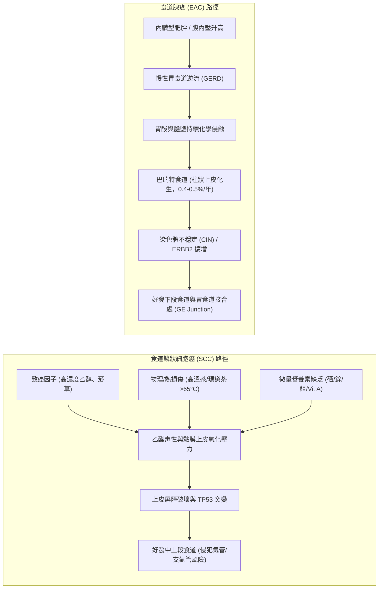
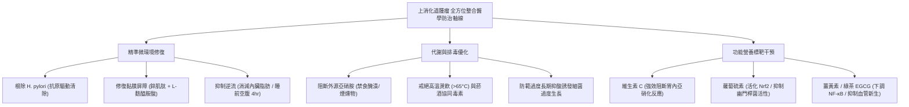

# 上消化道惡性腫瘤的精準醫學剖析與全方位整合防治策略（Upper Gastrointestinal Tract Cancers）
- **主講人/來源**：David Kelsen, MD（摘錄自 Harrison's Principles of Internal Medicine, Ch. 80）/ 臨床腫瘤與功能醫學轉譯整合
- **核心主旨**：從分子病理基因組學、慢性黏膜屏障損傷、微生物菌相失衡到免疫微環境，全方位解構食道、胃及小腸惡性腫瘤的致病機轉，並建構涵蓋精準腫瘤醫學、早期生物標記篩檢與功能性代謝營養干預的臨床處置藍圖。

---

## 一、 核心要點精華（Executive Clinical Summary）

- **核心病理生理機制**：
  - **慢性黏膜發炎與組織化生（Metaplasia-Dysplasia Cascade）**：長期的化學/物理性刺激（胃食道逆流之胃酸膽鹽、極高溫熱飲、酒精與菸草代謝物乙醛）誘發黏膜上皮持續損傷與修復異常，促使食道扁平上皮轉化為柱狀腺體黏膜（巴瑞特食道，Barrett’s Esophagus，年癌變率約 0.4–0.5%）。
  - **微生物異位與致癌亞硝基化合物（Nitrosamines）生成**：在胃酸缺乏（Atrophic Gastritis、長期過度抑酸或胃切除術後）狀態下，硝酸鹽還原菌大量繁殖，將外源性食物（醃漬、煙燻物）的硝酸鹽轉化為強致癌性亞硝酸鹽；*Helicobacter pylori* 感染引發進行性胃黏膜萎縮並募集骨髓幹細胞（Bone Marrow Stem Cells）異常異位分化。
  - **基因體不穩定性與驅動突變**：包括 *TP53* 早期突變失活、*CDH1* 胚系突變導致的上皮細胞黏附蛋白（E-cadherin）缺乏（瀰漫浸潤型胃癌）、微衛星不穩定（MSI-H/dMMR）、以及受體酪胺酸激酶擴增（*HER2/ERBB2*, *VEGFA*）。
- **演講亮點與臨床洞察**：
  - **組織發源與分子特徵的跨器官同質性**：TCGA 研究指出，食道鱗狀細胞癌在轉錄組與分子圖譜上更接近「頭頸部鱗狀細胞癌」，而非食道腺癌；食道腺癌則與胃癌之染色體不穩定型（CIN）高度同質，顛覆傳統解剖位置分類，指向相同的致癌驅動機制。
  - **微生物清除的腫瘤攔截作用（Cancer Interception）**：前瞻性隨機對照研究證實，根除 *H. pylori* 不僅能預防初發胃癌，亦可顯著降低具胃癌家族史一等親族群及早期胃癌內視鏡術後第二原發癌之發生率。
  - **淋巴瘤的微生物依賴性與逆轉契機**：胃 MALT 淋巴瘤（佔胃惡性腫瘤約 3%）高度依賴 *H. pylori* 的抗原刺激，單純抗生素除菌治療即可在無 t(11;18) 染色體轉位患者中達到完全緩解（Complete Remission）。

---

## 二、 核心評估指標與功能醫學檢驗（Assessment & Lab Testing）

| 檢測項目 / 生物標記 | 臨床意義與評估目標 | 理想 / 關注數值標準（若有提及） |
| :--- | :--- | :--- |
| **幽門螺旋桿菌檢驗** (UBT / Stool Ag / 切片) | 評估胃黏膜促發炎原兇，作為胃腺癌及 MALT 淋巴瘤之一級預防標靶 | 陰性（治療後需確認呼氣試驗轉陰） |
| **MSI / dMMR 檢測** (PCR 或 IHC 檢測 MLH1/MSH2 等) | 評估 DNA 錯配修復缺失、高腫瘤突變負荷（TMB）；預測免疫檢查點抑制劑（PD-1）之療效與預後 | MSI-H / dMMR 代表具極佳免疫治療反應與相對良好預後 |
| **HER2 (ERBB2) 擴增/過度表現** (IHC / FISH) | 評估轉移性胃/食道腺癌使用標靶藥物（Trastuzumab / T-DXd）之適應性 | IHC 3+ 或 IHC 2+ 併 FISH 陽性（約佔 20–25% 陽性率） |
| **PD-L1 綜合陽性評分 (CPS)** | 評估腫瘤微環境免疫逃逸程度，指導免疫抑制劑（如 Pembrolizumab / Nivolumab）處方 | CPS ≥ 1%（或臨床研究指定門檻 ≥ 5–10%） |
| **CDH1 胚系基因檢驗** | 評估遺傳性瀰漫型胃癌（HDGC）及小葉性乳腺癌風險 | 帶有病理性突變者應臨床諮詢預防性全胃切除術（Prophylactic Gastrectomy） |
| **鐵質與發炎代謝全套** (Ferritin, Fe, TIBC, CBC) | 鑑別隱極性消化道出血所致缺鐵性貧血，評估 Plummer-Vinson 症候群 | 排除缺鐵性貧血（低 Ferritin/高 TIBC）與慢性發炎性貧血 |
| **體抑素受體顯像 (Ga-68 DOTATATE)** | 神經內分泌腫瘤（NET）分期及放射性配體標靶治療評估 | 腫瘤呈現 Ga-68 DOTATATE 高攝取（Avid），指導生長抑素類似物治療 |

---

## 三、 關鍵機制詳解與投影片重點筆記

### 1. 食道癌的雙元病理光譜與上皮微環境損傷（SCC vs. EAC）

- **鱗狀細胞癌（SCC）**：集中於中上段食道，主要驅動因子為菸酒協同作用（酒精作為溶劑促進致癌物穿透，其代謝物乙醛具直接 DNA 毒性）、嚼檳榔（Areca nut）、極熱飲品燙傷與微量元素缺乏；分子譜系顯示其與 HPV 關聯性極低，但與頭頸部鱗癌高度相似。
- **腺癌（EAC）**：西方國家佔比 >75%，高度集中於下段食道及 GE 交界處。肥胖造成的腹內高壓與食道下括約肌失弛，誘發胃酸及膽汁酸逆流反覆沖刷，導致黏膜腸化生（Barrett's Esophagus），並在 *TP53* 突變與非整倍體（Aneuploidy）累積下演化為腺癌。

### 2. 胃腺癌的四大分子亞型（TCGA 分型）與臨床意義
依據 The Cancer Genome Atlas (TCGA) 多平台基因體分析，胃腺癌劃分為四種截然不同的分子亞型，主導後續精準治療方向（如圖 80-2 所示）：
1. **EBV 相關型（EBV-positive, ~9%）**：
   - 特徵：極高頻率的 *PIK3CA* 突變、高頻率 *PD-L1/PD-L2* 過度表現、極度廣泛的 CpG 島甲基化（EBV-CIMP）、*CDKN2A* 沉默。
   - 臨床切入：對免疫檢查點抑制劑（PD-1/PD-L1 阻斷劑）高度敏感。
2. **微衛星不穩定型（MSI, ~22%）**：
   - 特徵：高突變負荷（Hypermutation）、*MLH1* 啟動子甲基化沉默、胃 CIMP 表型。
   - 臨床切入：多見於年長者及胃竇部，預後最佳；對常規單一氟化嘧啶輔助化療反應有限，但對免疫療法反應顯著。
3. **基因體穩定型（Genomically Stable, GS, ~20%）**：
   - 特徵：富集於**瀰漫型組織學（Lauren Diffuse Type / 印戒細胞癌）**、*CDH1* 及 *RHOA* 體細胞突變、*CLDN18–ARHGAP* 基因融合、細胞黏附分子缺失。
   - 臨床切入：臨床預後最差，易發生腹膜廣泛轉移（Peritoneal Carcinomatosis）與皮革胃（Linitis Plastica），對傳統化療敏感度低。
4. **染色體不穩定型（Chromosomally Unstable, CIN, ~50%）**：
   - 特徵：好發於胃食道接合部（GE Junction）與賁門、多為腸型組織學、高頻率 *TP53* 突變、受體酪胺酸激酶基因擴增（*ERBB2/HER2*, *VEGFA*, *GATA4/6*）。
   - 臨床切入：標靶治療的重點族群（Trastuzumab 抗 HER2 治療標的）。

### 3. 微生物驅動的腫瘤學模型：胃 MALT 淋巴瘤與 t(11;18) 轉位
- **病因機轉**：胃邊緣區 B 細胞淋巴瘤（MALT 淋巴瘤）約佔原發性胃惡性腫瘤 3–5%，為慢性 *H. pylori* 免疫抗原長期刺激引發的多株 B 細胞增殖演變為單株惡性淋巴瘤。
- **分子檢查點**：
  - **t(11;18)(q21;q21) 轉位陰性**：腫瘤完全依賴 *H. pylori* 的抗原刺激生存，採用標準四聯抗生素除菌治療後，完全緩解率可高達 70–80%（需耐心追蹤 12–18 個月）。
  - **t(11;18) 轉位陽性**：該轉位產生 *API2-MALT1* 嵌合蛋白，直接持續激活下游 **NF-κB** 抗凋亡訊息傳遞路徑，脫離對細菌抗原的依賴性；對除菌治療無效，臨床必須改採放射治療（Involved-site RT 24–30 Gy）或抗 CD20 單株抗體（Rituximab）。
- **手術定位**：原發性胃淋巴瘤**絕對不應行常規外科切除手術**，除非合併穿孔或無法控制的大出血。

### 4. 胃腸道基質瘤 (GIST) 與神經內分泌腫瘤 (NET)
- **GIST**：源自 Cajal 間質細胞（腸道起搏細胞），~70% 為梭狀細胞型，由 *c-KIT*（CD117 陽性）或 *PDGFRA* 激酶驅動突變所主導；外科採楔形局部切除（因極少淋巴轉移，無需廣泛清掃），高復發風險者需給予標靶藥物 Imatinib 輔助治療 3 年。
- **胃 NET**：第 1 型（萎縮性胃炎/高胃泌素血症驅動，良性居多，內視鏡切除）；第 2 型（Zollinger-Ellison 症候群/MEN-1 相關）；第 3 型（散發性、胃泌素正常、惡性度高易轉移，需行正規根除性手術）。

---

## 四、 臨床介入處方與生活型態策略（Therapeutic Strategies）

### 1. 功能性營養素 / 植化素補充（Mucosal Protection & Chemoprevention）
- **高活性維生素 C（Ascorbic Acid）**：
  - *臨床機轉*：胃液中充足的維生素 C 能強效阻斷硝酸鹽在胃酸環境下轉化為致癌物亞硝基化合物（*N*-nitroso compounds, NOCs）。
  - *臨床應用*：針對慢性萎縮性胃炎或具胃癌家族史者，每日分次補充 500–1000 mg。
- **鋅肌肽（Zinc Carnosine）與 L-麩醯胺酸（L-Glutamine）**：
  - *臨床機轉*：促進黏膜上皮再生、穩定胃黏膜緊密連接蛋白（Tight Junctions）、抑制促發炎細胞因子（TNF-α、IL-8），加速逆流性食道炎與胃黏膜損傷癒合。
  - *劑量建議*：Zinc Carnosine 75 mg BID；L-Glutamine 5–10 g/天（分次空腹服用）。
- **十字花科蘿蔔硫素（Sulforaphane）**：
  - *臨床機轉*：經由活化 Nrf2-ARE 抗氧化酵素通路，誘導 Phase II 解毒酵素（GST、NQO1），並對抗生素耐藥的 *H. pylori* 具天然抗菌抑制作用。
- **高生物利用度薑黃素（Curcumin）**：
  - *臨床機轉*：抑制致癌核心轉錄因子 NF-κB 及 COX-2，阻斷由發炎驅動的異型增生級聯反應。

### 2. 飲食與禁食策略（Dietary & Metabolic Interventions）
- **阻絕強致癌性亞硝胺源**：
  - 嚴格戒除高鹽、煙燻、炭烤及亞硝酸鹽醃漬加工肉品（如培根、臘肉、醃菜）。高鹽飲食會破壞胃黏膜黏液保護屏障，大幅加乘 *H. pylori* 致癌毒力。
- **排除物理熱性熱灼傷**：
  - 戒絕高溫飲食習慣（如滾燙熱茶、湯品、瑪黛茶，溫度 >65°C）。慢性熱灼傷引發食道黏膜反覆潰破出血，是食道鱗癌的關鍵推手。
- **時間限制性進食（TRF）與胃排空管理**：
  - **夜間禁食視窗**：就寢前 3–4 小時嚴格禁食與飲水，避免臥位時胃內容物反流侵蝕食道下段，減輕夜間酸暴露（Nocturnal Acid Exposure）。
  - **控制熱量以消減內臟脂肪**：體重減輕 5–10% 可顯著降低腹腔內壓力，改善裂孔疝氣（Hiatal Hernia）並逆轉逆流性發炎。

### 3. 環境毒素阻斷 / 代謝排毒 / 生活型態
- **菸酒協同毒性戒斷**：
  - 酒精代謝物乙醛為第一類致癌物；乙醇更會充當溶劑加速菸草焦油中多環芳香烴（PAHs）及亞硝胺穿透食道黏膜。臨床必須同步強力戒菸與戒酒。
- **謹慎評估長期質子幫浦抑制劑（PPI）依賴**：
  - 長期無指徵濫用 PPI 會導致嚴重低胃酸（Hypochlorhydria），破壞胃部無菌屏障，使上消化道細菌過度繁殖（SIBO），進而增加內源性亞硝基化反應。應以功能性黏膜修復與生活型態替代無止境的過度抑酸。

---

## 五、 臨床實踐行動清單（Key Takeaways）

1. **高危族群一級預防——積極根除幽門桿菌**：
   - 凡有胃癌一等親家族史、不明原因缺鐵性貧血、萎縮性胃炎或曾行早期胃腫瘤切除之患者，應常規以呼氣試驗（UBT）或糞便抗原排查 *H. pylori*，陽性者即刻予以標準除菌治療，阻斷致癌級聯反應。
2. **警覺「紅旗警訊」並果斷內視鏡檢查**：
   - 面對中老年患者（>40–50 歲）出現新發吞嚥困難（Dysphagia）、吞嚥疼痛（Odynophagia）、不明原因貧血、體重驟降或頑固性消化不良，**首選高解析度上消化道內視鏡（EGD）併組織切片**，切勿單純開立制酸劑或安排鋇劑造影而延誤早期診斷。
3. **胃黏膜病變之分子精準標靶常規化**：
   - 所有確診晚期/轉移性胃癌及食道癌患者，病理組織應常規加做 **HER2 (IHC/FISH)**、**PD-L1 (CPS)** 及 **MSI/dMMR** 檢測。HER2 陽性者第一線給予 Trastuzumab 併化療；MSI-H 患者應優先納入免疫檢查點抑制劑（如 Pembrolizumab）治療路徑。
4. **胃原發淋巴瘤切忌冒然手術**：
   - 確診胃 MALT 淋巴瘤時，首要步驟為評估 *H. pylori* 狀態及檢測 **t(11;18) 染色體轉位**。轉位陰性者優先採用抗生素除菌療法，除非併發急性穿孔或不可止之大出血，手術切除已非此類病患之標準治療。
5. **落實抗發炎黏膜修復生活處方**：
   - 衛教高逆流風險病患：戒絕 >65°C 熱飲、禁絕加工醃漬肉品、減輕內臟脂肪，並於睡前 4 小時嚴格禁食。輔以維生素 C（防亞硝化）與鋅肌肽/麩醯胺酸（修復上皮屏障），從源頭撲滅黏膜慢性發炎轉化為惡性腫瘤的微環境溫床。